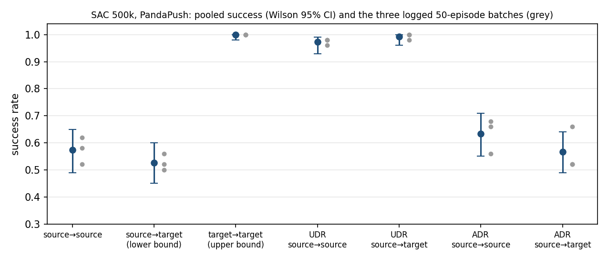
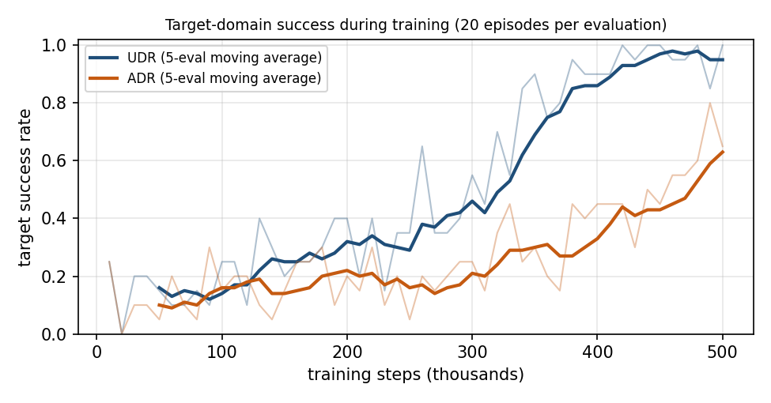

# Reinforcement Learning for Robotic Control under Sim-to-Sim Domain Shift

Team course project, *Fundamentals of Artificial Intelligence, Machine and Deep Learning*, Politecnico di Torino,
AY 2025/26. Four authors: Samuel Clemos, Matteo Marello, Shaheer Abdullah, Umesh Bansari.
Read the [original course report](course_report.pdf), prepared with the CVPR LaTeX template.

**Question.** A policy trained on one simulated dynamics setting is deployed on another. How much performance is
lost, and how much of it does domain randomization recover?

**Setup.** PandaPush-v3 (panda-gym, PyBullet). Source domain: 1 kg cube. Target domain: 5 kg cube. SAC
(Stable-Baselines3), 500k timesteps, training seed 0, 50 episodes per evaluation with deterministic actions and unseeded environment resets. Lower bound:
trained on source, tested on target. Upper bound: trained and tested on target. Domain randomization over cube mass:
UDR (uniform, [0.5, 8.0] kg) and ADR (boundaries adapted from recent performance). A preliminary part implements
REINFORCE, REINFORCE with a constant baseline and Actor-Critic from scratch on Hopper-v4 (MuJoCo).

## Course results

### PPO vs. SAC at 100k steps

The Phase 3 pilot used 50 evaluation episodes per configuration and one recorded training seed.
In the source-to-target setting, PPO succeeded in **6/50** episodes (mean return −3.766) and SAC
in **12/50** (−3.263). The team selected SAC for the 500k experiments below. This pilot measured
performance at one budget and seed. [PPO and SAC evaluation logs](shaheer_phase3_100k_deliverables/)

### SAC and domain randomization at 500k steps

The [submitted results table](results/part2/summaries/umesh_phase4_final_results.csv) reports one
50-episode target-domain evaluation per configuration. Std is the standard deviation of episode returns.

| Configuration | Mean return | Std | Success rate |
|---|---:|---:|---:|
| source → target (lower bound) | -2.727 | 2.328 | 0.50 |
| target → target (upper bound) | -0.416 | 0.236 | 1.00 |
| UDR, source → target | -0.502 | 0.420 | 1.00 |
| ADR, source → target | -1.920 | 1.893 | 0.66 |

## Post-submission analysis (November 2026)

The group's evaluation log contains three complete evaluation batches of the 500k matrix (20, 25 and 26 May 2026,
50 episodes each per configuration). The course table above reports the last batch. Descriptive pooling
([`followup/evaluation_variability.py`](followup/evaluation_variability.py), no new runs):



| Configuration | Success per batch | Pooled (Wilson 95% CI) |
|---|---|---|
| source → target (lower bound) | 0.52 / 0.56 / 0.50 | 0.53 [0.45, 0.60] |
| target → target (upper bound) | 1.00 / 1.00 / 1.00 | 1.00 [0.98, 1.00] |
| UDR, source → target | 1.00 / 0.98 / 1.00 | 0.99 [0.96, 1.00] |
| ADR, source → target | 0.52 / 0.52 / 0.66 | 0.57 [0.49, 0.64] |

UDR succeeded in **149/150** episodes, compared with **79/150** for source-only SAC and **150/150**
for target-trained SAC. ADR succeeded in **85/150**, a pooled difference of 4 percentage points
from source-only SAC. That difference is inconclusive across these batches. The per-configuration
Wilson intervals summarize episode-level uncertainty under a common independent Bernoulli model.
Checkpoint paths lack hashes, and environment resets were unseeded. The logs therefore leave both
checkpoint identity and training-seed variability unresolved.

The second figure tracks target success throughout training. Each point summarizes 20 episodes
with the policy at that training step. Over the final ten evaluations, UDR succeeded in **192/200**
episodes and ADR in **106/200**. These measurements span different checkpoints along each learning curve.



A seeded re-evaluation of the released checkpoints is prepared in
[`followup/reevaluate_checkpoints.py`](followup/reevaluate_checkpoints.py) (fixed per-episode reset seeds, 5 × 50
episodes per configuration). **It has not been run yet**: PyBullet has no prebuilt Windows wheel for current Python
versions, and the run is pending on a Linux/Colab machine.

## Course results on Hopper (from-scratch policy gradients)

`samuel_part/reports/comparison_metrics.csv`, seed 42:

| Run | Episodes | Best eval return | Final eval return |
|---|---:|---:|---:|
| REINFORCE | 1000 | 346.7 | 243.2 |
| REINFORCE, baseline 20 | 1000 | 223.2 | 219.7 |
| REINFORCE, baseline 1000 | 1000 | 181.0 | 97.8 |
| Actor-Critic | 1000 | 466.2 | 466.2 |
| REINFORCE, baseline 20 | 15000 | 444.3 | 321.3 |
| Actor-Critic | 15000 | 1010.4 | 168.0 |

Actor-Critic recorded the highest peak in the listed runs and finished its 15,000-episode run well below that peak.
The 1,000-episode REINFORCE run with baseline 1,000 recorded lower returns than the run with baseline 20.
All rows use seed 42, so these runs describe observed behavior without isolating the effect of the baseline.

## Repository layout

| Path | Content |
|---|---|
| `part1/` | REINFORCE / baseline / Actor-Critic (`agent.py`), Hopper training and evaluation |
| `part2/` | SB3 training/evaluation for PandaPush, UDR/ADR wrapper (`rand_wrapper.py`), experiment launcher; bundled `panda-gym` (MIT) |
| `samuel_part/` | Hopper results, plots, hyperparameters |
| `shaheer_phase3_*` | PPO/SAC 100k comparison, SAC 500k baselines, source/target checkpoints |
| `results/part2/` | UDR/ADR checkpoints and the full evaluation log |
| `followup/` | Post-submission analysis (this README's follow-up section) |
| `docs/DETAILED_GUIDE.md` | Full submission README: every command, hyperparameter and result path |

## Reproduce

```bash
python -m venv .venv && source .venv/bin/activate      # Python 3.10/3.11, Linux or Colab recommended
pip install -r requirements.txt
pip install -e part2/panda-gym
python -m py_compile part1/*.py part2/*.py              # syntax check
python part2/run_part2_experiments.py --algorithm sac --include-udr --include-adr --dry-run   # print the matrix
python followup/evaluation_variability.py               # recompute the follow-up table from the log
python followup/plot_variability.py                    # regenerate the batch-variability figure
python followup/training_curves.py                      # target success during training (UDR vs ADR)
```

Full training commands are in [`docs/DETAILED_GUIDE.md`](docs/DETAILED_GUIDE.md). 500k SAC runs take several hours
each on a CPU.

## Contributions

Per the team's role assignment: Samuel Clemos, Hopper policy-gradient algorithms (Phases 1–2); Shaheer Abdullah,
PPO/SAC baselines (Phase 3); Umesh Bansari, UDR/ADR domain randomization (Phase 4); Matteo Marello, report writing,
code integration and final consistency checks. Commit history: the initial pipeline scaffold (`ce633c0`) and the
final integration (`ef946ae`) were committed by Matteo; each phase's results were committed by the teammate who ran
them. Matteo added the post-submission analysis in `followup/` with AI assistance.

## Limitations

One training seed; 50-episode evaluations with unseeded resets; a single dynamics parameter (cube mass) is shifted;
sim-to-sim only, with no claim about real-robot transfer.
